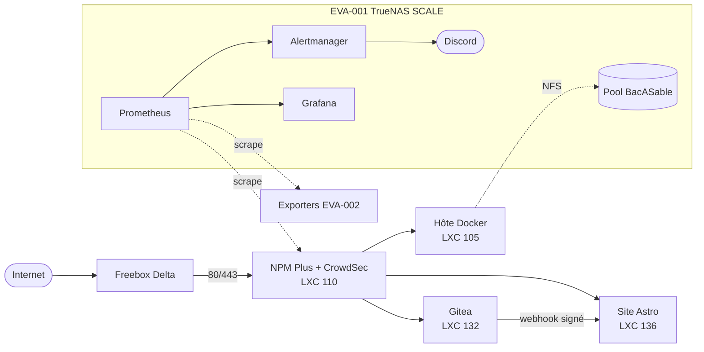

# homelab

Configuration versionnée de mon homelab : hyperviseur Proxmox VE, stockage TrueNAS SCALE (ZFS),
stacks Docker et supervision Prometheus/Grafana. Les fichiers sont des copies assainies de ce qui
tourne réellement : aucun secret, les adresses IP sont remplacées par des noms `*.lan`.

Présentation détaillée : <https://laurenttailliez.dev/projects/homelab/>

> Relevé du 23/11/2026. Seuls les invités démarrés sont comptés ; les modèles (`900x`) et les VM
> arrêtées sont mentionnés à part.

## Matériel et état

| Nœud | Rôle | Matériel | État relevé |
| :--- | :--- | :--- | :--- |
| EVA-002 | Proxmox VE 9.2 | Ryzen 7 5700U, 62 Go RAM, NVMe 500 Go + SSD 2 To | 39 LXC et 5 VM démarrés |
| EVA-001 | TrueNAS SCALE | Pool `BacASable` : miroir 2 × 8 To, cache L2ARC NVMe 1 To | 5,1 Tio utilisés sur 7,1 Tio, dernier scrub sans erreur |
| Freebox Delta | Passerelle, DHCP | — | Redirige 80/443 vers NPM Plus |

À part : 3 LXC arrêtés, la VM OPNsense (installée mais arrêtée), les VM de test arrêtées et les
modèles. Le nœud NixOS EVA-003 est hors service ; sa configuration est archivée sur ma forge Gitea.



## Ce qui est en place

- **Reverse proxy** : NPM Plus (LXC 110) termine le TLS et ajoute HSTS et les en-têtes de sécurité.
  CrowdSec et son bouncer nginx tournent sur le même conteneur.
- **Contrôle d'accès** : 5 vhosts sur 17 sont restreints par liste d'accès NPM. Authelia (LXC 113)
  et Pocket-ID (LXC 138) tournent, mais aucun vhost n'est encore branché en forward-auth.
- **Forge et CI/CD** : Gitea (LXC 132) avec un `act_runner`. Le site est déployé par un webhook
  signé HMAC-SHA256 : le conteneur web fait un `git fetch`, compile et remplace le dossier `dist`
  (voir [docs/ci-cd.md](docs/ci-cd.md)).
- **Supervision** : Prometheus, Alertmanager et Grafana tournent sur TrueNAS, donc hors de
  l'hyperviseur surveillé. 39 règles d'alerte chargées (36 noms distincts : 3 alertes onduleur
  sont définies deux fois) et 6 règles d'enregistrement. Les alertes partent sur Discord.
- **Sauvegardes** : vzdump chaque dimanche à 01:00 (zstd, mode snapshot, 2 versions gardées) sur
  le SSD 2 To de l'hyperviseur.

## Limites connues

Ce dépôt décrit l'état réel, défauts compris :

- **Pas de copie hors site.** Les sauvegardes vzdump restent sur la même machine que les invités ;
  aucune réplication ZFS ni synchronisation cloud n'est configurée.
- **6 LXC privilégiés sur 42**, dont l'hôte Docker (LXC 105).
- **n8n en HTTP sur le LAN** avec `N8N_SECURE_COOKIE=false`. Cible : passer derrière NPM Plus en HTTPS.
- **SSO non branché** : Authelia et Pocket-ID ne protègent encore aucun vhost.
- **Pas d'exercice de restauration documenté** pour l'instant.
- Les exporters de la stack média (exportarr, qBittorrent) ne sont pas versionnés ici.

## Contenu du dépôt

```text
.
├── docs/               architecture réseau, stockage ZFS, supervision, sécurité, CI/CD
├── monitoring/         prometheus.yml, règles d'alerte, Alertmanager, Blackbox, tableau Grafana
├── proxmox/
│   ├── host/           interfaces réseau et storage.cfg de l'hyperviseur
│   └── lxc/examples/   configurations LXC commentées (105, 110, 132)
├── scripts/            exporters Prometheus maison (Proxmox, SMART/vzdump) et unités systemd
└── stacks/             compose Docker en service, images épinglées par digest
```

L'inventaire complet des LXC reste dans un dépôt privé ; seuls 3 exemples commentés sont publiés.

## Conventions

- Images Docker épinglées en `tag@sha256:digest`. Le digest est celui de l'image qui tourne,
  relevé avec `docker image inspect`. Une mise à jour est donc un changement de digest explicite.
- Secrets hors du dépôt : chaque stack documente ses variables dans `.env.example`, sans valeur.
- La CI ([.github/workflows/ci.yml](.github/workflows/ci.yml)) bloque en cas d'échec de gitleaks
  (historique complet), ShellCheck, ruff, de la syntaxe Compose ou de `promtool check`, et
  refuse toute image non épinglée.

## Licence

MIT, voir [LICENSE](LICENSE).
