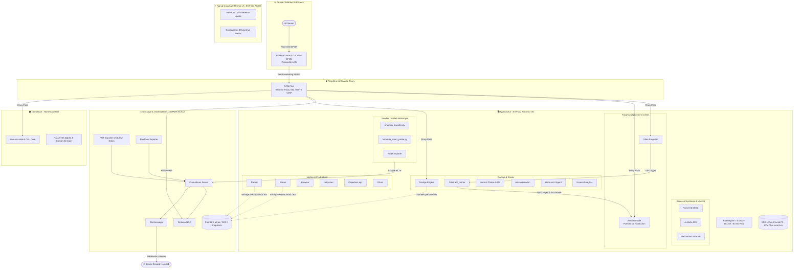

# 🏰 Homelab EVA-002 & Architecture Proxmox VE

[](https://www.proxmox.com)
[](https://www.truenas.com)
[](https://nixos.org)
[](https://www.docker.com)
[](LICENSE)

> **Un homelab de production géré comme du code.**  
> Infrastructure auto-hébergée haute performance articulée autour de l'hyperviseur Proxmox VE (**EVA-002**), du stockage ZFS résilient (**TrueNAS SCALE**), du nœud d'inférence d'IA déclaratif (**EVA-003 NixOS**) et de la domotique centrale (**Home Assistant**).

Retrouvez les projets et réalisations associées sur [laurenttailliez.dev](https://laurenttailliez.dev).

---

## 🧭 Philosophie & Principes Directeurs

- **Infrastructure as Code (IaC) & Reproductibilité** : Chaque configuration système, règle réseau, unité systemd, composition Docker et configuration NixOS est déclarative, versionnée sous Git et traçable.
- **Observabilité & Métrologie Découplée** : Collecte continue Prometheus des sondes matérielles (NVMe SMART, cgroups v2, Freebox FTTH, Onduleur Eaton), découplée sur le NAS TrueNAS pour garantir l'indépendance de la supervision même en cas de maintenance de l'hyperviseur.
- **Résilience & Disponibilité** : Pool ZFS Copy-on-Write en miroir, sauvegardes vzdump hebdomadaires compressées en `zstd`, rétention automatisée et plans de reprise testés.
- **Défense en Profondeur & Zéro Confiance** : Reverse proxy durci (NPM Plus) avec en-têtes de sécurité stricts (HSTS, CSP), segmentation des conteneurs LXC non privilégiés (`unprivileged: 1`), double facteur (MFA/OIDC), utilisateur de déploiement CI/CD restreint via `rrsync` et politique stricte zéro secret en clair.

---

## 🏛️ Architecture Globale de l'Infrastructure



---

## 🖥️ Matrice des Machines & Domaines de Services

### Nœuds Physiques & Systèmes Hôtes

| Machine / Nœud | OS / Système | Rôle Principal | Sous-réseau | Caractéristiques |
| :--- | :--- | :--- | :--- | :--- |
| **Freebox Delta** | Freebox OS | Passerelle FTTH 10G-EPON, DHCP local, Switch | LAN `192.168.0.0/24` | Connectivité WAN Fibre 10G |
| **EVA-002** | Proxmox VE 9.2 | Hyperviseur bare-metal, conteneurs LXC et VMs | LAN `192.168.0.0/24` | AMD Ryzen 7 5700U (8C/16T), 64 Go RAM, SSD NVMe 500 Go |
| **EVA-001** | TrueNAS SCALE | Stockage central ZFS, Monitoring Prometheus/Grafana | LAN `192.168.0.0/24` | Pool ZFS en miroir, Partages NFS/CIFS |
| **EVA-003** | NixOS | Nœud de calcul & Inférence IA locale (LLMs) | LAN `192.168.0.0/24` | Déclaratif flakes / configuration NixOS |
| **Home Assistant** | HAOS / Core | Gestion domotique, suivi des consommations prises Zigbee | LAN `192.168.0.0/24` | Intégration capteurs et métrologie électrique |

### Cartographie par Domaines & Catégories de Services

| Domaine / Catégorie | Services & Composants | Ce que ça démontre |
| :--- | :--- | :--- |
| **Hyperviseur Proxmox VE (EVA-002)** | Découpage en conteneurs LXC légers et VMs ciblées, profils d'énergie Ryzen, bridged networking | Optimisation des ressources bare-metal, haute densité de conteneurs sous cgroups v2, efficience thermique. |
| **Reverse proxy NPM Plus** | NPM Plus (Nginx Proxy Manager), terminaison TLS Let's Encrypt, HSTS, WAF, filtrage d'en-têtes | Sécurisation du point d'entrée unique, gestion centralisée des certificats SSL/TLS et politiques de sécurité web. |
| **Forge & CI/CD** | Forge Git locale Gitea, act_runner isolé, déploiement continu rsync restreint via `rrsync` SSH | Chaîne CI/CD entièrement auto-hébergée, isolation des jobs de build et déploiements à privilèges minimaux. |
| **Automatisation** | n8n, workflows d'orchestration et pipelines automatisés | Interconnexion d'APIs, gestion d'alertes événementielles et automatisation de tâches récurrentes. |
| **Média** | Stack Servarr (Radarr, Sonarr, Prowlarr, Lidarr, Readarr, Jellyseerr) | Gestion modulaire et automatisée de collections multimédias avec volumes de stockage déportés. |
| **Observabilité** | Prometheus Server, Grafana NOC, Blackbox Exporter, Alertmanager, sondes locales NVMe/cgroups | Supervision proactive complète, métrologie découplée sur stockage distinct et alertage multi-canal. |
| **Stockage** | TrueNAS SCALE, pool ZFS Copy-on-Write en miroir, instantanés, partages NFS/CIFS | Résilience des données, intégrité ZFS contre la corruption silencieuse et séparation nette calcul/stockage. |
| **IA** | EVA-003 NixOS, Ollama, inférence locale LLM, configuration déclarative Flakes | Infrastructure déclarative reproductible pour modèles de langage locaux sans dépendance cloud. |
| **Domotique** | Home Assistant, passerelle Zigbee, métrologie électrique des prises connectées | Télémétrie énergétique temps réel, corrélation charge CPU / consommation électrique et domotique locale. |
| **Sécurité** | Authentification 2FA/MFA (Authelia, Pocket-ID), WatchYourLAN (ARP scan), CrowdSec, durcissement SSH | Architecture de défense en profondeur, moindre privilège (`unprivileged: 1`), surveillance réseau et zero-trust. |

---

## 🗂️ Arborescence du Dépôt

```text
.
├── .github/
│   └── workflows/ci.yml           # Pipeline GitHub Actions (Markdown lint, ShellCheck, Gitleaks)
├── docs/                          # Documentation d'ingénierie détaillée
│   ├── architecture-reseau.md     # Schéma des flux réseau, reverse proxy, plan d'adressage
│   ├── stockage-zfs.md            # Pool ZFS miroir, LVM-Thin, ARC, scrubs
│   ├── monitoring.md              # Prometheus, Grafana NOC, Blackbox, alertes électriques
│   ├── securite.md                # Durcissement NPM Plus, rrsync restreint, MFA, CrowdSec
│   └── ci-cd.md                   # Pipeline Gitea Actions (prettier/eslint/astro check/build/rsync)
├── monitoring/                    # Configurations de la stack de supervision (déportée NAS)
│   ├── prometheus.yml             # Scraping des sondes Proxmox, NAS, Freebox, Blackbox
│   ├── blackbox.yml               # Modules de sondage ICMP, HTTP 2xx et certificats SSL
│   ├── alertmanager.yml           # Règles de routage et webhooks Discord
│   └── rules/                     # Règles de détection (alertes système, UPS, puissance)
├── nixos/                         # Configurations déclaratives pour le nœud EVA-003
├── proxmox/
│   ├── host/                      # Fichiers de configuration assainis de l'hyperviseur EVA-002
│   │   ├── interfaces             # Exemple assaini /etc/network/interfaces (bridge vmbr0)
│   │   └── storage.cfg            # Exemple assaini des pools de stockage locaux et distants
│   └── lxc/                       # Configurations de référence des conteneurs LXC
│       ├── README.md              # Documentation des modèles et politique d'assainissement
│       └── examples/              # 3 exemples commentés (Gitea forge, NPM Plus, Dockge gros volume)
├── scripts/                       # Outillage système et sondes d'infrastructure
│   ├── proxmox_exporter.py        # Sonde CPU/RAM/cgroup v2 pour Prometheus (port 9221)
│   ├── homelab_smart_probe.py     # Sonde NVMe SMART / TBW (port 9188)
│   └── systemd/                   # Unités systemd des sondes locales
├── stacks/                        # Définitions Docker Compose assainies (LXC 105 Dockge)
│   ├── dockge/                    # Stack du gestionnaire Dockge
│   ├── immich/                    # Stack de sauvegarde et reconnaissance d'images
│   ├── n8n/                       # Stack d'automatisation et orchestrateur de flux
│   ├── hermes-agent/              # Stack de l'agent autonome IA
│   ├── flaresolverr/              # Contournement de protections et Byparr
│   ├── umami/                     # Métriques web analytics respectueuses de la vie privée
│   └── gitea-runner/              # Runner d'exécution CI/CD act_runner
├── CONTRIBUTING.md                # Normes de contribution et conventions de commits
├── LICENSE                        # Licence MIT
└── README.md                      # Présentation générale du Homelab
```

---

## 🔒 Confidentialité & Assainissement

Ce dépôt respecte des règles strictes d'assainissement :
- **Inventaire complet archivé en privé** : Pour préserver la sécurité de l'infrastructure, l'inventaire exhaustif des conteneurs LXC et configurations brutes d'hôtes est volontairement non publié sur ce dépôt public. Il est conservé et versionné dans un dépôt privé interne dédié à la maintenance et à la reconstruction d'urgence. Seuls 3 exemples de référence documentés et assainis sont présentés dans `proxmox/lxc/examples/`.
- **Zéro secret** : Tous les mots de passe, tokens API, secrets de sessions et clés privées sont remplacés par des variables d'environnement ou des gabarits `.env.example`.
- **Aucune IP sensible ni adresse MAC** : Les identifiants matériels sont masqués (`XX:XX:XX:XX:XX:XX`) et les adresses IP individuelles d'hôtes sont remplacées par des variables ou le plan d'adressage global `/24`.
- **Audit automatisé** : Détection systématique de fuite de tokens ou d'identifiants lors de l'intégration continue via Gitleaks.

---

## 📜 Licence

Projet distribué sous licence **MIT**. Voir le fichier [LICENSE](LICENSE) pour plus de précisions.
