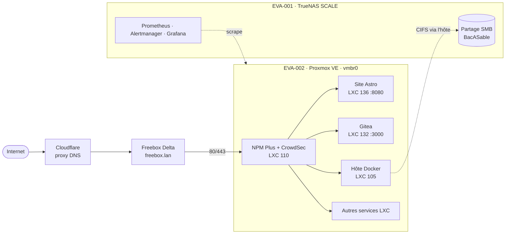

# Architecture réseau

Relevé du 23/11/2026. Les adresses sont remplacées par des noms `*.lan`.

## Topologie

Le réseau est plat : un seul sous-réseau /24, sans VLAN. La Freebox Delta fait passerelle, DHCP et
redirection de ports. L'hyperviseur n'a qu'un pont, `vmbr0`, branché sur sa carte filaire `enp4s0`
(voir [proxmox/host/interfaces](../proxmox/host/interfaces)). Tous les LXC et VM y sont reliés.

## Chemin d'une requête publique

1. Le DNS public des domaines pointe vers Cloudflare (enregistrements proxifiés).
2. Cloudflare relaie vers l'IP publique de la Freebox, qui redirige 80 et 443 vers NPM Plus.
3. NPM Plus (LXC 110) termine le TLS et choisit l'hôte proxy selon le nom demandé. Les plages
   d'adresses Cloudflare sont déclarées dans `set_real_ip_from` et l'en-tête `CF-Connecting-IP`
   est lu (`real_ip_header`) : les journaux et CrowdSec voient l'adresse du client, pas celle de
   Cloudflare.
4. La requête est relayée en HTTP vers le service sur le LAN.

NPM Plus porte 18 hôtes proxy. Leur protection est détaillée dans [securite.md](securite.md).

## Nœuds

| Nœud | Rôle | Remarque |
| :--- | :--- | :--- |
| Freebox Delta | Passerelle, DHCP, NAT | Seul point d'entrée depuis Internet |
| EVA-002 | Proxmox VE 9.2 | 39 LXC et 5 VM démarrés |
| EVA-001 | TrueNAS SCALE | Stockage et supervision |
| EVA-003 | — | Hors service, non joignable |

La VM OPNsense (VM 100) est installée mais arrêtée : la Freebox reste la seule passerelle.

## Accès au stockage

Les invités ne montent pas le NAS eux-mêmes. L'hyperviseur monte le partage SMB `BacASable` en
CIFS (stockage Proxmox `nas.local`), puis le transmet au LXC 105 par un point de montage `mp0`
(`/data` dans le conteneur, voir [105-dockge.conf](../proxmox/lxc/examples/105-dockge.conf)).

Pourquoi : un LXC non privilégié n'a pas le droit de monter un système de fichiers réseau. Le
montage au niveau de l'hôte contourne cette limite. Le partage NFS de TrueNAS existe mais il est
désactivé.

## Limites

- Pas de VLAN : un invité compromis voit tout le LAN.
- Pas de pare-feu entre les invités. Le pare-feu Proxmox n'est pas utilisé et OPNsense est arrêté.
- Un seul lien actif (`enp4s0`), la deuxième carte `eno1` est débranchée : pas de redondance.
