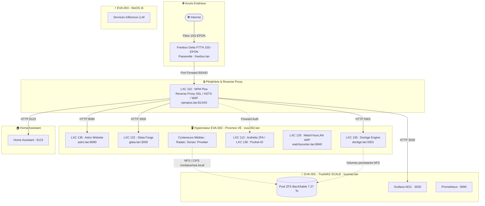

# Architecture Réseau & Flux

## 1. Vue d'Ensemble & Topologie Réseau

L'infrastructure réseau homelab de Laurent est pensée selon une séparation rigoureuse des responsabilités, une exposition maîtrisée vers Internet et une segmentation logique des flux locaux.

---

## 2. Plan d'Adressage & Rôles des Équipements

Toutes les machines et services sont interconnectés sur le sous-réseau local privé `192.168.0.0/24`. Aucune adresse IP publique ni adresse MAC physique n'est exposée.

| Nœud / Service | IP Locale | Port(s) d'Écoute | Fonction & Rôle dans l'Infrastructure |
| :--- | :--- | :--- | :--- |
| **Passerelle Freebox Delta** | `freebox.lan` | 80, 443 (WAN), DHCP | Terminaison FTTH 10G-EPON, distribution DHCP, redirection de ports 80/443 vers NPM Plus |
| **EVA-002 (Proxmox VE)** | `eva-002.lan` | `8006` (WebUI), `22` (SSH) | Hyperviseur principal, hébergeant le bridge `vmbr0` sur lequel communiquent tous les conteneurs LXC |
| **EVA-001 (TrueNAS SCALE)** | `truenas.lan` | `443` (WebUI), `2049` (NFS), `445` (SMB) | Nœud de stockage central ZFS (`BacASable`) et hébergement de la stack d'observabilité |
| **LXC 110 (NPM Plus)** | `npmplus.lan` | `80, 443, 81` (Admin) | Reverse proxy d'entrée, terminaison TLS Let's Encrypt, en-têtes HTTP de sécurité |
| **LXC 136 (Astro Website)** | `astro.lan` | `8080` (HTTP), `22` (SSH restreint) | Serveur Nginx servant le site portfolio compilé `laurenttailliez.dev` |
| **LXC 132 (Gitea)** | `gitea.lan` | `3000` (HTTP), `222` (SSH Git) | Forge Git locale auto-hébergée et déclencheur des pipelines CI/CD |
| **LXC 105 (Dockge)** | `dockge.lan` | `5001` (WebUI), ports stacks | Moteur Docker pour les microservices (Immich, n8n, Hermes, runner CI) |
| **LXC 129 (WatchYourLAN)** | `watchyourlan.lan` | `8840` | Analyse permanente de la table ARP et détection de nouveaux équipements |
| **EVA-003 (NixOS IA)** | Réseau local | Ports d'inférence API | Nœud bare-metal dédié au calcul et modèles de langage en local |
| **Home Assistant** | Réseau local | `8123` | Plateforme centrale de domotique et télérelève de puissance Zigbee |

---

## 3. Stratégie de Sécurisation des Flux Réseau

### Surface d'Exposition Minimale
Seuls les flux HTTPS (port 443) et HTTP (port 80 pour le challenge ACME Let's Encrypt) sont redirigés de la Freebox vers le conteneur LXC 110 (**NPM Plus**). Aucun port d'administration système (SSH, Proxmox 8006, TrueNAS 443, Dockge 5001) n'est exposé directement à Internet. L'accès à distance s'effectue exclusivement en réseau privé ou via passerelle sécurisée.

### En-têtes de Sécurité HTTP & Reverse Proxy
NPM Plus applique sur chaque vhost :
- **HSTS (HTTP Strict Transport Security)** avec `max-age=31536000; includeSubDomains; preload` pour forcer le chiffrement.
- **Content Security Policy (CSP)** et protection contre le clickjacking (`X-Frame-Options: SAMEORIGIN`).
- **Filtrage des User-Agents** malveillants et blocage des scanners d'URL connus.

### Surveillance ARP Continue (WatchYourLAN)
Le conteneur LXC 129 écoute en mode passif et sonde régulièrement la table ARP du sous-réseau `192.168.0.0/24`. Tout nouvel équipement branché sur le switch ou connecté en Wi-Fi déclenche un avertissement immédiat.
