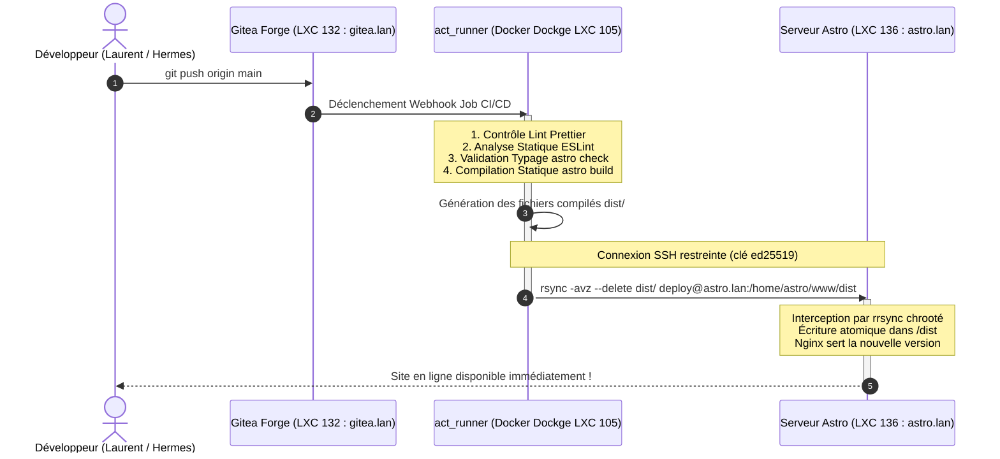

# Pipeline CI/CD & Déploiement Continu

## 1. Vue d'Ensemble du Flux de Déploiement

Le homelab intègre une chaîne d'intégration et de déploiement continu (CI/CD) entièrement souveraine, hébergée en local et automatisant la validation du code, les tests statiques, le build et la publication en production.



---

## 2. Étapes Clés du Pipeline Gitea Actions

Chaque commit poussé sur la branche principale déclenche un workflow rigoureux composé de 4 phases séquentielles :

### Étape 1 : Formatage & Style de Code (`prettier`)
Vérifie la conformité stylistique des fichiers source JavaScript, TypeScript, Astro et JSON selon les règles du projet :
```bash
npx prettier --check .
```
Garantit qu'aucun écart de mise en forme n'est introduit dans le dépôt de production.

### Étape 2 : Analyse Statique (`eslint`)
Détecte les erreurs de syntaxe, les variables inutilisées, les anti-patterns et les potentielles failles de sécurité au niveau du code applicatif :
```bash
npx eslint . --ext .js,.ts,.astro
```

### Étape 3 : Contrôle de Typage & Validité (`astro check`)
Valide la cohérence des types TypeScript dans les composants `.astro` et les fichiers utilitaires, ainsi que l'intégrité des liens et propriétés de composants :
```bash
npx astro check
```
Tout problème de typage bloque immédiatement le pipeline, interdisant tout déploiement cassé.

### Étape 4 : Compilation de Production (`astro build`)
Compile l'ensemble des pages statiques, génère les assets CSS/JS optimisés, applique la minification et crée le dossier de distribution `dist/` prêt pour la production :
```bash
npm run build
```

---

## 3. Déploiement Atomique & Sécurisé (`rsync` via `rrsync`)

Une fois la compilation réussie avec succès, les fichiers du dossier `dist/` sont synchronisés de manière différentielle vers le conteneur LXC 136 (`astro-eva-002`) :

```bash
rsync -avz --delete \
  -e "ssh -i /tmp/deploy_key -o StrictHostKeyChecking=accept-new" \
  ./dist/ deploy@astro.lan:/home/astro/www/dist/
```

### Pourquoi `rsync` avec l'option `--delete` ?
- **Synchronisation Différentielle** : Seuls les fichiers modifiés sont transférés à travers le réseau local, réduisant le temps de déploiement à moins de 3 secondes.
- **Nettoyage Automatique (`--delete`)** : Les anciens fichiers obsolètes générés lors de précédents builds sont immédiatement purgés sur le serveur cible.
- **Zéro Interruption de Service (Downtime)** : Le serveur Nginx sert les requêtes en continu pendant la mise à jour atomique des fichiers statiques.

---

## 4. Configuration du Runner CI/CD (`act_runner`)

Le runner CI/CD fonctionne dans la stack Docker Dockge (LXC 105) sous forme de conteneur `gitea/act_runner` :
- Il communique localement avec l'instance Gitea (LXC 132 : `gitea.lan:3000`).
- Il instancie des conteneurs de build Node.js éphémères (`node:22-bookworm`).
- La clé privée SSH temporaire de déploiement lui est fournie sous forme de secret de repository sécurisé, injectée uniquement pendant l'étape de déploiement.
