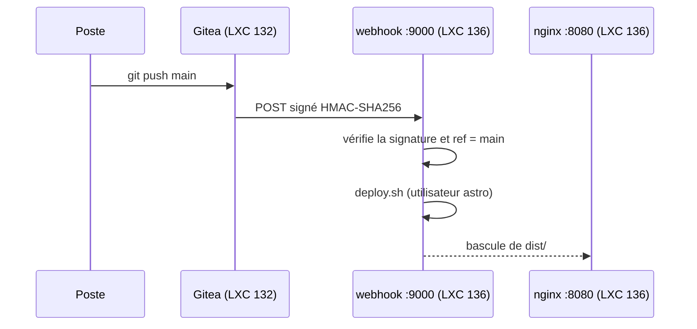

# CI/CD

Relevé du 23/11/2026.

## Forge : Gitea (LXC 132)

Les dépôts de travail sont sur Gitea. Les jobs CI tournent dans `act_runner` (stack
[gitea-runner](../stacks/gitea-runner/compose.yaml), hébergée par le LXC 105). Chaque job s'exécute
dans un conteneur Docker éphémère, avec la syntaxe des workflows GitHub Actions.

## Site laurenttailliez.dev

### Intégration continue

Le workflow `.gitea/workflows/ci.yaml` du dépôt du site tourne à chaque push et à chaque pull
request :

1. `npm ci` : installation exacte depuis `package-lock.json` ;
2. `npm run format:check` (Prettier) ;
3. `npm run lint` (ESLint) ;
4. `npm run check` (`astro check` : types et templates) ;
5. `npm run build`.

### Déploiement

Le LXC 136 fait tourner [webhook](https://github.com/adnanh/webhook), que Gitea appelle à chaque
push sur `main`. Le script `deploy.sh` :

1. prend un verrou `flock` : deux pushs rapprochés ne lancent pas deux builds en même temps ;
2. fait `git fetch` puis `git reset --hard origin/main` : le dossier de travail reflète exactement
   la branche ;
3. relance `npm ci` seulement si l'empreinte de `package-lock.json` a changé ;
4. compile dans `.dist-new` et vérifie que `index.html` existe ;
5. remplace `dist/` par `.dist-new`.

nginx sert `/home/astro/www/dist`. Si le build échoue, l'ancien `dist/` reste en place : le site
ne sert jamais une version à moitié compilée. Le dernier déploiement a pris 27 secondes, `npm ci`
compris.

### Limite

Le webhook part au moment du push, en parallèle de la CI : **un commit qui échoue en CI est quand
même déployé** s'il compile. Pour corriger, il faudrait déclencher le déploiement à la fin du
workflow, après les vérifications.

## Ce dépôt (GitHub)

[.github/workflows/ci.yml](../.github/workflows/ci.yml) fait échouer le commit si une étape échoue :

| Étape | Contrôle |
| :--- | :--- |
| gitleaks | Secrets dans tout l'historique (`fetch-depth: 0`). Le binaire est vérifié par SHA-256 avant exécution |
| ShellCheck | Scripts shell |
| ruff | Exporters Python (règles dans `ruff.toml`) |
| `docker compose config` | Syntaxe de chaque stack, avec son `.env.example` |
| Épinglage | Refuse toute image sans `@sha256:` |
| `promtool`, `amtool` | Configuration Prometheus, règles et Alertmanager, avec les images de production |

Les actions GitHub sont épinglées par SHA de commit : un tag peut être déplacé par le mainteneur
de l'action, un SHA non.
