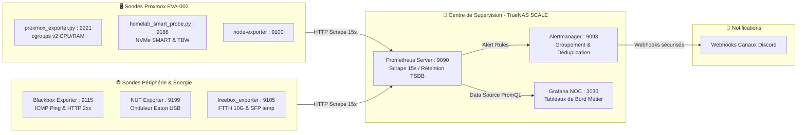

# Monitoring & Observabilité (NOC)

## 1. Architecture de Métrologie Découplée

Le principe architectural clé du monitoring homelab est le **découplage** : la stack de supervision (Prometheus, Grafana, Alertmanager) réside sur le serveur TrueNAS SCALE (EVA-001) et non sur l'hyperviseur de production (EVA-002).

---

## 2. Collecteurs & Exporters Spécialisés

### 1. `proxmox_exporter.py` (Port 9221)
Sonde développée sur mesure en Python, interrogeant directement l'arborescence `/sys/fs/cgroup/` (cgroups v2) et l'API Proxmox VE :
- Collecte par conteneur LXC et machine virtuelle : temps CPU cumulé (`pve_lxc_cpu_seconds_total`), mémoire résidente et swaps.
- Évite les surcharges liées à des requêtes API REST répétées en lisant directement les compteurs du noyau Linux.

### 2. `homelab_smart_probe.py` (Port 9188)
Supervision de l'état d'usure des disques NVMe et SATA :
- Métriques collectées : température du contrôleur, pourcentage d'usure de vie (`percentage_used`), octets écrits cumulés (TBW - Terabytes Written) et erreurs critiques de média.

### 3. Blackbox Exporter (Port 9115)
Sonde synthétique externe vérifiant en continu :
- **ICMP Ping** : Détecte en moins de 10 secondes l'injoignabilité d'un hôte ou d'une passerelle.
- **HTTP 2xx & SSL** : Vérifie la validité des certificats Let's Encrypt et la bonne réponse HTTP des services web exposés via NPM Plus.

### 4. NUT Exporter (Onduleur Eaton)
Supervise l'alimentation sans interruption (ASI / UPS) :
- État de charge de la batterie, tension d'entrée secteur, puissance délivrée en Watts et autonomie restante estimée.

---

## 3. Modèle Mathématique de Répartition de Puissance Électrique

L'hyperviseur EVA-002 est raccordé à une prise connectée Zigbee mesurant en temps réel la consommation électrique globale ($P_{\text{mesurée}}$, typiquement ~25W au repos). Afin d'imputer précisément cette consommation à chaque service, le modèle suivant est implémenté sous Prometheus/Grafana :

$$P_{\text{guest}} = \left( \frac{\text{RAM}_{\text{guest}}}{\sum \text{RAM}_{\text{all}}} \times P_{\text{idle}} \right) + \left( \frac{\text{CPU\_Usage}_{\text{guest}}}{\sum \text{CPU\_Usage}_{\text{all}}} \times (P_{\text{mesurée}} - P_{\text{idle}}) \right)$$

- **Socle Fixe ($P_{\text{idle}}$)** : Représente la consommation plancher de la carte mère, de la mémoire vive et de la dissipation passive (estimée par le 5e percentile glissant sur 72h). Il est réparti proportionnellement à la RAM allouée à chaque conteneur.
- **Part Dynamique** : Correspond au surcroît d'énergie consommé lors des phases de calcul (compilation CI/CD, encodage vidéo, reconnaissance faciale Immich). Elle est attribuée au prorata exact des cycles CPU cgroups v2 consommés par le conteneur.

---

## 4. Règles d'Alerte Majeures (Alertmanager)

| Règle | Sévérité | Déclenchement | Playbook d'Action |
| :--- | :---: | :--- | :--- |
| `HoteInjoignablePing` | **Critical** | Échec ICMP Blackbox > 2 min | Notification Discord urgente, vérification alimentation et switch |
| `ConteneurProxmoxArrete` | **Warning** | Conteneur à l'état stoppé > 5 min | Signalement pour vérification d'un arrêt volontaire ou crash |
| `ZpoolNonSain` | **Critical** | `zpool_health != 1` > 1 min | Exécution immédiate de `zpool status -v` sur TrueNAS |
| `ZpoolPresquePlein` | **Warning** | Remplissage pool > 80 % | Purge des snapshots anciens et nettoyage des données temporaires |
| `OnduleurSurBatterie` | **Critical** | Flag `OB == 1` > 10 s | Décompte du temps d'autonomie restante ; extinction propre si < 30 % |
| `RyzenTctlElevee` | **Warning** | Température CPU > 85°C > 10 min | Contrôle de la ventilation et application de profil `ryzen-power-tuning` |
