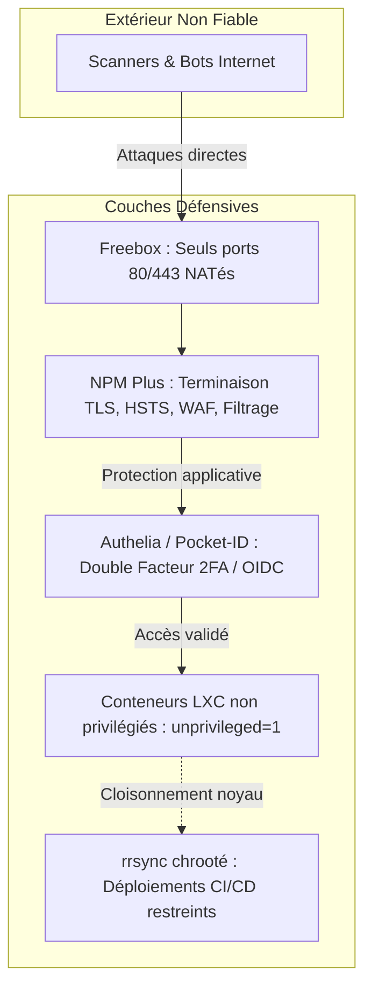

# Sécurité, Durcissement & Cloisonnement

## 1. Principes de Défense en Profondeur

La politique de sécurité du homelab suit le principe du moindre privilège, du cloisonnement strict et de la protection périmétrique renforcée.



---

## 2. Reverse Proxy Durci : NPM Plus & En-têtes HTTP

Le point d'entrée unique de tous les flux web externes est le conteneur LXC 110 exécutant **NPM Plus** (variante durcie de Nginx Proxy Manager) :

### En-têtes de Sécurité Appliqués
- **HSTS (HTTP Strict Transport Security)** :  
  `Strict-Transport-Security: max-age=31536000; includeSubDomains; preload`  
  Garantit que le navigateur communique exclusivement en HTTPS et empêche les attaques par rétrogradation de protocole (SSL Stripping).
- **Content Security Policy (CSP)** :  
  Contrôle les origines autorisées pour le chargement de scripts, styles et images, limitant drastiquement les risques de Cross-Site Scripting (XSS).
- **Protection Anti-Clickjacking** :  
  `X-Frame-Options: SAMEORIGIN` et `X-Content-Type-Options: nosniff`.
- **Referrer Policy** :  
  `Referrer-Policy: strict-origin-when-cross-origin`.

---

## 3. Déploiements CI/CD Verrouillés via `rrsync`

Pour permettre au pipeline d'intégration continue de mettre à jour le site portfolio statique sur le LXC 136 (`astro-eva-002`) sans lui accorder de droits d'administration sur le système, une restriction par **`rrsync`** (Restricted rsync) est mise en place.

### Configuration SSH dans `/home/deploy/.ssh/authorized_keys` :
```text
command="/bin/rrsync /home/astro/www/dist",no-port-forwarding,no-X11-forwarding,no-agent-forwarding,no-pty ssh-ed25519 AAAAC3... gitea-deploy@astro-eva-002
```

### Mécanismes de Protection Activés :
1. **Chroot de Répertoire (`/home/astro/www/dist`)** : Le script Perl `rrsync` intercepte la commande rsync et interdit tout chemin hors de la racine autorisée (protection contre `../..`).
2. **Désactivation de PTY (`no-pty`)** : Empêche l'ouverture d'un shell interactif (`/bin/bash` ou `/bin/sh`). Même en disposant de la clé SSH, aucun attaquant ne peut exécuter de commande shell arbitraire.
3. **Blocage des Redirections (`no-port-forwarding`, `no-agent-forwarding`)** : Interdit la création de tunnels réseau ou l'usurpation de clés SSH transférées.

---

## 4. Cloisonnement LXC & Gestion des Privilèges

### Conteneurs Non Privilégiés (`unprivileged: 1`)
La quasi-totalité des conteneurs LXC sont créés en mode non privilégié.
- L'UID `0` (root) à l'intérieur du conteneur est remappé vers un UID standard non privilégié sur l'hôte (typiquement `100000+`).
- En cas de compromission d'un processus à l'intérieur du conteneur, une élévation de privilèges ne confère aucun droit root sur le noyau de l'hôte physique.

### Authentification Forte & MFA
- **Authelia (LXC 113)** et **Pocket-ID (LXC 138)** : Fournissent une couche d'authentification centralisée 2FA (TOTP / Clés de sécurité FIDO2 WebAuthn) en amont des interfaces d'administration sensibles.
- Les accès aux tableaux de bord de supervision ou de gestion sont systématiquement soumis à une validation de second facteur.

### Détection d'Intrusions (CrowdSec & WatchYourLAN)
- **WatchYourLAN (LXC 129)** : Scanne passivement la couche de liaison (ARP) pour alerter immédiatement de toute présence d'une adresse MAC non inventoriée sur le switch ou le Wi-Fi.
- **CrowdSec / Règles Fail2ban** : Analyse des logs HTTP et SSH pour bloquer dynamiquement les adresses IP agressives et partager les signaux de menaces avec la communauté.

---

## 5. Politique Zéro Secret & Confidentialité

- **Aucun Secret dans Git** : Aucun token d'API, mot de passe de base de données ou clé privée SSH n'est commité dans les dépôts.
- **Gabarits `.env.example`** : Les configurations de stacks sous `stacks/` documentent les variables sans exposer les valeurs sensibles.
- **Anonymisation Réseau** : Les adresses MAC matérielles physiques sont remplacées par des gabarits masqués (`XX:XX:XX:XX:XX:XX`) et les adresses IP publiques sont exclues de toute documentation.
