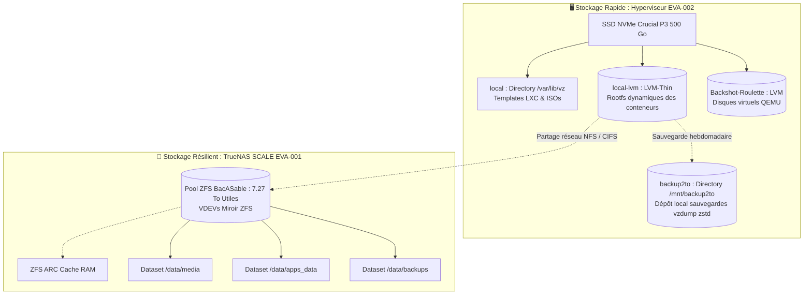

# Stockage ZFS & Architecture des Données

## 1. Conception du Stockage : Deux Niveaux Complémentaires

L'infrastructure distingue le stockage système hyperviseur à très haute vitesse et le stockage capacitif hautement résilient.

---

## 2. Le Pool ZFS `BacASable` (7.27 To) sur TrueNAS SCALE

Le cœur capacitif et persistant du homelab est hébergé sur TrueNAS SCALE à travers le pool ZFS nommé **`BacASable`**, totalisant **7.27 To** d'espace exploitable.

### Pourquoi ZFS ? Principes Fondamentaux

1. **Copy-on-Write (CoW)** :  
   ZFS n'écrase jamais une donnée en place. Lorsqu'un bloc est modifié, il est écrit sur un nouvel emplacement libre avant que les pointeurs de métadonnées ne soient mis à jour de façon atomique. Ce mécanisme élimine le risque de corruption en cas de coupure de courant inopinée.

2. **Miroir ZFS (Mirror VDEVs)** :  
   Le pool est constitué en vdevs de disques en miroir. Cette disposition offre :
   - Une tolérance aux pannes matérielles (la perte d'un disque ne dégrade pas les données).
   - Des performances de lecture accrues, les requêtes étant réparties entre les disques du miroir.
   - Un temps de reconstruction (*resilver*) nettement plus court et moins stressant pour la mécanique que les configurations RAIDZ complexes à large parité.

3. **Checksums & Intégrité des Blocs (Auto-guérison / Self-Healing)** :  
   Chaque bloc écrit est associé à une somme de contrôle (Fletcher4 / SHA-256). Lors de la lecture, ZFS vérifie mathématiquement que la donnée lue correspond au checksum. En cas d'incohérence (*bit rot* ou secteur défectueux silencieux), ZFS lit automatiquement la copie saine sur le miroir et répare le bloc corrompu à la volée.

4. **ZFS ARC (Adaptive Replacement Cache)** :  
   La mémoire vive (RAM) du serveur TrueNAS sert de cache intelligent multi-niveaux (combinant récence et fréquence d'accès). Les requêtes de lecture répétées sont servies directement depuis la RAM à débit mémoire sans solliciter les disques mécaniques.

5. **Snapshots Instantanés & Immuables** :  
   Grâce au Copy-on-Write, la création d'un snapshot ZFS est instantanée et ne consomme aucun espace initialement. Les snapshots conservent l'historique temporel des datasets, permettant de restaurer un fichier ou un dossier complet en quelques secondes en cas de fausse manipulation ou d'attaque par rançongiciel.

6. **Scrubs Périodiques (Contrôle Proactif)** :  
   Une tâche planifiée de *scrub* balaie régulièrement l'intégralité du pool ZFS pour lire chaque bloc et vérifier son empreinte cryptographique. Tout bloc altéré est immédiatement détecté et réparé avant qu'une seconde panne ne survienne.

---

## 3. Stockage Système sur Proxmox VE : LVM-Thin

Sur l'hyperviseur EVA-002, le SSD NVMe Crucial P3 est partitionné de manière pragmatique :
- **`local`** (`/var/lib/vz`) : Répertoire classique stockant les gabarits de distribution pour LXC (`vztmpl`) et les images ISO.
- **`local-lvm`** (LVM-Thin) : Fournit des volumes logiques alloués dynamiquement pour les rootfs des conteneurs. Chaque conteneur ne consomme sur le SSD que l'espace réellement écrit, avec le support natif des instantanés pour les sauvegardes `vzdump`.
- **`nas.local`** (Montage CIFS/NFS) : Point de montage réseau pointant vers le pool `BacASable` de TrueNAS (`truenas.lan`), permettant aux LXC applicatifs (Dockge, Radarr, Sonarr, Readarr) d'accéder aux bibliothèques massives sans alourdir le stockage local du mini-PC.
- **`backup2to`** (`/mnt/backup2to`) : Stockage cible réservé aux archives `vzdump` compressées en `zstd` générées chaque dimanche matin.
